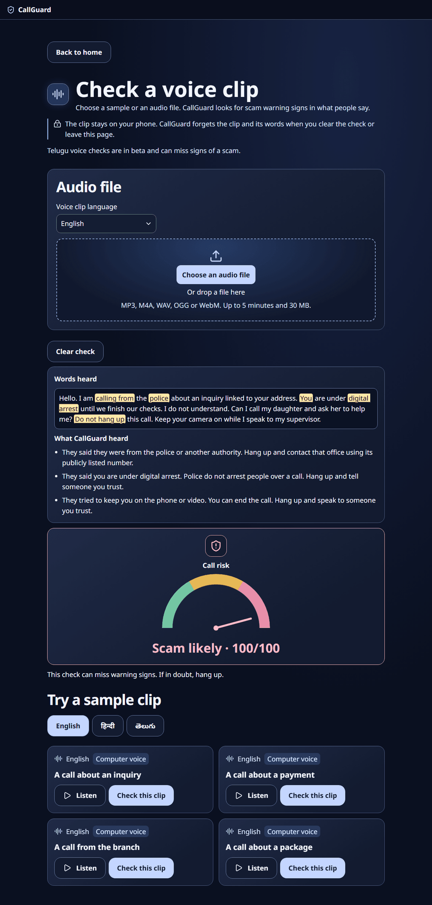
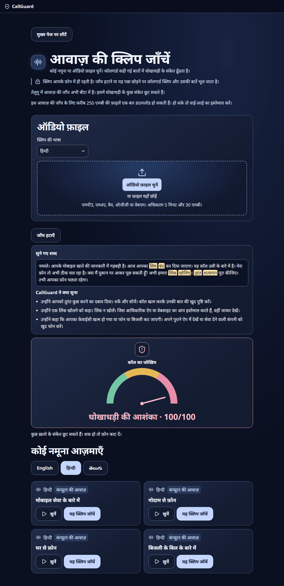
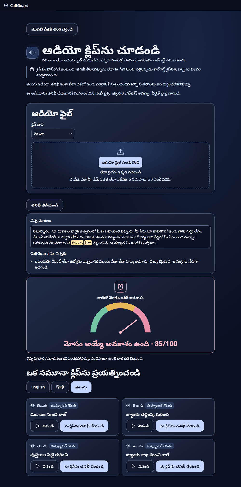
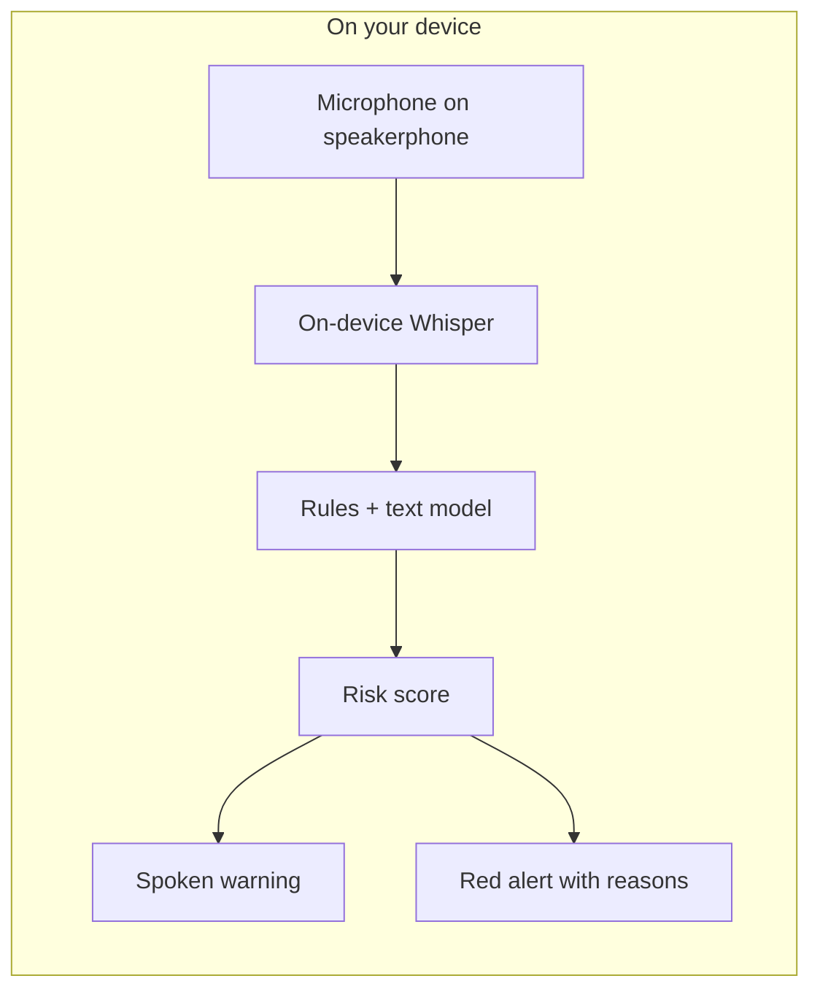

# CallGuard

CallGuard warns older adults in India about scam calls in Telugu, Hindi or English while keeping their audio and words on their device.

Put the call on speaker and tap **Guard this call**. If CallGuard hears strong scam cues, it gives a red **Hang up now** warning, explains the cues and offers India's **1930** helpline for online financial fraud. It can also speak the warning using an installed voice. Built for the GeeksforGeeks × OpenAI Build with Codex challenge. [Live app](https://callguard-six.vercel.app) · [National Cyber Crime Reporting Portal](https://cybercrime.gov.in/Webform/Accept.aspx)

## Try it in 30 seconds

1. Open [CallGuard](https://callguard-six.vercel.app) and choose English, हिन्दी or తెలుగు.
2. Tap **Try a sample scam call**. The scripted demo keeps the microphone off and reaches the red alert in a few seconds. Look for the explanation below the alert.
3. Tap **I hung up** to go home. Use **Try it yourself** to see which words triggered a rule, or **Check a voice clip** to check one of the bundled computer-voice samples.

## Screenshots

| Language | Landing | Clip checker | Listening | Red alert |
| --- | --- | --- | --- | --- |
| English | [Landing](docs/evidence/img/stage-4a-landing-en-mobile-chromium.png) | [Clip checker](docs/evidence/img/stage-4a-clip-en-mobile-chromium.png) | [Listening](docs/evidence/img/stage-4b-listening-en-mobile-chromium.png) | [Red alert](docs/evidence/img/stage-4b-alert-en-mobile-chromium.png) |
| Hindi | [Landing](docs/evidence/img/stage-4a-landing-hi-mobile-chromium.png) | [Clip checker](docs/evidence/img/stage-4a-clip-hi-mobile-chromium.png) | [Listening](docs/evidence/img/stage-4b-listening-hi-mobile-chromium.png) | [Red alert](docs/evidence/img/stage-4b-alert-hi-mobile-chromium.png) |
| Telugu | [Landing](docs/evidence/img/stage-4a-landing-te-mobile-chromium.png) | [Clip checker](docs/evidence/img/stage-4a-clip-te-mobile-chromium.png) | [Listening](docs/evidence/img/stage-4b-listening-te-mobile-chromium.png) | [Red alert](docs/evidence/img/stage-4b-alert-te-mobile-chromium.png) |

<p>
  
  
  
</p>

The Stage 4b reviewer ran a clean `npm ci` outside the sandbox. Lint and typecheck passed, all 281 Vitest tests passed, and the production build passed (precache 21 entries, 1089.77 KiB). `npm audit --omit=dev --audit-level=high` found 0 vulnerabilities. Playwright end-to-end tests passed 42/42 on desktop and Pixel 7, including axe WCAG 2.1 AA and offline PWA coverage. The screenshot configuration passed 9/9 and produced the six reviewed Stage 4b mobile Chromium PNGs (200-290 KB each). The live smoke test (`playwright.live.config.ts`) against [CallGuard on Vercel](https://callguard-six.vercel.app) passed the privacy-header checks and confirmed that the English demo reaches the red alert.

Run `npm run screenshots -- --project mobile-chromium --grep "listening and red alert screens"` to regenerate the six images from scripted calls. The screenshots show a simulated microphone indicator and use no real call audio.

## How it works



CallGuard has no processing server. The browser turns speech into words in four-second chunks. The rules check for tactics in the rolling text window, and a TF-IDF logistic regression model can add up to 20 points. Scores below 30 show **Safe**, 30–69 show **Be careful**, and 70 or more show **Scam likely**. The screen keeps the highest score and the rule reasons heard so far. Every red alert includes at least one rule reason. [Scoring](src/detect/score.ts) · [Classifier training and metrics](training/README.md)

## Privacy

| AGENTS.md rule | What it means for you | Test coverage |
| --- | --- | --- |
| 1. User-started only | The microphone starts after an explicit tap to guard or start a speech check and browser permission. It stops on **Stop** or **I hung up**, after 60 seconds of silence, or when you leave or switch away from the page. | [Browser start, stop and sample tests](tests/e2e/guard.spec.ts) · [60-second timeout](tests/session.test.ts) |
| 2. Nothing leaves the device by default | CallGuard processes audio and text on the device. It sends neither and has no backend for calls or analytics. | [Network API test](tests/privacy.test.ts) · [Outbound host policy](tests/hosting.test.ts) |
| 3. Nothing is stored | Audio and words stay in memory and are cleared when the session ends. **Clear check** discards the clip check. Browser storage keeps the four preferences described in the privacy notice. | [Session cleanup](tests/session.test.ts) · [Clip buffer wiping](tests/clip-audio.test.ts) · [Storage and logging checks](tests/privacy.test.ts) |
| 4. Always visible | The screen shows a microphone indicator while the microphone is active, including during the red alert. | [Indicator before, during and after guarding](tests/e2e/guard.spec.ts) |
| 5. Family alerts are opt-in and user-sent | Off by default. If enabled, **Tell my family** opens WhatsApp with a fixed one-line message. You press Send. The link contains no transcript or reasons. | [Default setting and fixed WhatsApp link](tests/e2e/guard.spec.ts) |
| 6. Cloud dependencies are labelled | The download screen shows model preparation. The browser downloads the app and speech runtime from Vercel and model files from Hugging Face. These downloads contain no call data. Transcription runs on the device, and spoken warnings use matching local voices. | [On-demand runtime and offline reuse](tests/e2e/guard.spec.ts) · [Local-voice and browser speech API checks](tests/privacy.test.ts) |

The app shell can open offline after its first visit and service worker activation. Using Whisper offline also requires the speech files for the chosen model to finish downloading. [Privacy notice](PRIVACY.md) · [Six project requirements](AGENTS.md#non-negotiable-privacy-rules)

## What it detects

Thirteen rules cover ten categories across five language and script forms: English, Devanagari Hindi, romanised Hindi, Telugu script and romanised Telugu. The rules also check mixed-script calls.

1. Requests for OTPs, UPI PINs, CVVs, card numbers or passwords.
2. Impersonation of police, CBI, ED, customs, TRAI, courts or RBI.
3. Threats of arrest, a case, an account freeze or digital arrest.
4. Demands to stay on video or keep the call secret from family.
5. Urgent deadlines and pressure to act immediately.
6. Requests to open a link or install an app such as AnyDesk, TeamViewer or an APK.
7. Transfers to an alleged safe or verification account.
8. Claims that a parcel in your name contains drugs or illegal items.
9. Threats of KYC expiry, SIM blocking or electricity disconnection.
10. Upfront fees for a lottery, prize, refund or job offer.

### Text evaluation

The fixed test set has 65 synthetic scam scripts based on public advisories and 65 synthetic safe scripts, including normal bank and courier calls. A separate set of 202 scripts trains the classifier. Recall is the share of scam scripts that reached red. The false-positive rate (FPR) is the share of safe scripts that reached red. [Test data](data/test.jsonl) · [Evaluation and per-category report](tests/eval.test.ts)

| Language and script | Rules only recall | Rules only FPR | Rules + model recall | Rules + model FPR |
| --- | ---: | ---: | ---: | ---: |
| Overall | 100% (65/65) | 0% (0/65) | 100% (65/65) | 0% (0/65) |
| English | 100% (20/20) | 0% (0/20) | 100% (20/20) | 0% (0/20) |
| Hindi (romanised) | 100% (20/20) | 0% (0/20) | 100% (20/20) | 0% (0/20) |
| Hindi (Devanagari) | 100% (10/10) | 0% (0/10) | 100% (10/10) | 0% (0/10) |
| Telugu (romanised) | 100% (7/7) | 0% (0/7) | 100% (7/7) | 0% (0/7) |
| Telugu (Telugu script) | 100% (8/8) | 0% (0/8) | 100% (8/8) | 0% (0/8) |

The independent reviewer tested unseen paraphrases. The original detector caught **2/22** scams and flagged **3/17** safe calls. The reviewer measured **18/22** scams caught and **2/17** safe calls flagged on the first revision, before follow-up fixes. That round caught 12/15 English and romanised Hindi scams and 6/7 scams in the other three forms. The fixed-set table above measures a separate dataset. [Independent review rounds](docs/evidence/README.md#review)

### Voice clip evaluation

These CPU measurements use the twelve shipped synthetic clips and the app's default model for each selected language. **Telugu voice checks are in beta.** [Audio evaluation](docs/evidence/audio-eval.md#bundled-voices-and-app-defaults)

| Shipped clips and default model | Correct verdicts | Scams caught |
| --- | ---: | ---: |
| English · Base · eSpeak NG | 4/4 | 2/2 |
| Hindi · Small · one MMS-TTS and three Indic Tiny TTS clips | 4/4 | 2/2 |
| Telugu (beta) · Small · Indic Tiny TTS | 2/4 | 0/2 |
| Total | 10/12 | 4/6 |

The optional Telugu fine-tune scored 3/4 on the shipped Telugu clips. It caught the OTP scam and missed the prize-fee scam. The app can use it for Telugu clip checks after the owner hosts the quantized export on Hugging Face or same-origin hosting. [Telugu Whisper export and hosting](docs/telugu-whisper.md)

### Limitations

- Detection depends on the words Whisper hears. Noise, accents, mixed languages or a slow device can cause misses. Some phones reserve microphone access for the call. Open **Settings → Speech check** to try the intended phone, or put the call on speaker and run CallGuard on a second device.
- Live guarding and auto-language clip checks use Whisper Base (about 77 MB). Selecting Hindi or Telugu for clips uses Whisper Small (about 250 MB) by default. The shared speech runtime adds about 23 MB before compression. A first download needs a connection, and browsers can evict cached files.
- A genuine request for a shared-login OTP can trigger a warning. A low score cannot establish the caller's identity. The text detector looks for scam tactics in what was said, including in computer-generated speech. Real-call detection accuracy is still unmeasured.

## Check your own audio file

In the app, open **Check a voice clip**, choose a file (MP3, M4A, WAV, OGG or WebM, up to five minutes and 30 MB), select its language or automatic detection, then tap **Check this clip**. Review the words and highlighted cues. Tap **Clear check** to clear the app's copy and result.

For local CPU evaluation, install FFmpeg and put it on your PATH. Keep private files in a folder outside the checkout.

```sh
npm run eval:audio -- <folder>
```

Add `--model small` before the folder to use Whisper Small. The runner recognises language and expected verdict from names such as `te-scam-01.m4a` and `hi-genuine-01.wav`. Private-folder runs print aggregate statistics. Real voices are never committed. Run `npm run eval:audio -- --model base` to reproduce a bundled Base sample run. [Audio evaluator](scripts/eval-audio.mjs)

## Local setup

Use Node.js 22 and npm from the repository root.

```sh
npm ci
npm run dev
npm test
npm run build
```

- Run `npm run lint`, `npm run typecheck` and `npm run test:eval` for lint, types and the fixed text evaluation.
- Install Chromium with `npx playwright install chromium`, then run `npm run test:e2e`. CI runs the desktop and Pixel 7 browser projects with retries. Automated axe checks cover WCAG 2.1 A/AA on the landing, clip checker and red alert. Playwright also checks offline startup, the manifest and on-demand caching of the speech runtime.
- On Windows, launch tests from an uppercase drive-letter path such as `C:\Users\DELL\callguard` if Vitest reports `Cannot read properties of undefined (reading 'config')` from a lowercase path.
- On Linux, install from the project root so `.npmrc` skips the unused ONNX Runtime CUDA download.
- Use Python 3.13 in a virtual environment for classifier training. Run `python -m pip install -r training/requirements.txt` and `python training/train.py` from the repo root. [Training and reproducibility](training/README.md)

## Stack and hosting

Vite, React and strict TypeScript power the interface, with Tailwind CSS and shadcn/ui components. Vite PWA and Workbox cache the shell. Transformers.js runs Whisper through WebGPU with a WASM fallback. Web Speech Synthesis uses installed local voices. A Python/scikit-learn trainer exports JSON for browser inference. GitHub Actions runs Vitest, Playwright and the Python reproducibility check. The Git-connected Vercel project serves the static `dist` build. [Hosting configuration](vercel.json)

Visual components from ThreeUI Community (MIT). The bundled clips use computer voices from eSpeak NG, Meta MMS-TTS and Sulabh Katiyar’s Indic Tiny TTS trained on AI4Bharat Rasa. [Third-party notices](THIRD_PARTY_NOTICES.md)

## How Codex was used

Codex researched the threat model, mapped the challenge stages, implemented the detector and browser flows, ran tests and incorporated independent review findings. The evidence pack links the work, PRs, CI runs, screenshots and the Stage 4b reviewer results. [Threat model](docs/understand.md) · [Delivery plan](docs/plan.md) · [Evidence pack](docs/evidence/README.md) · [90-second demo script](docs/evidence/demo-script.md)

## Licence

TBD by the author
